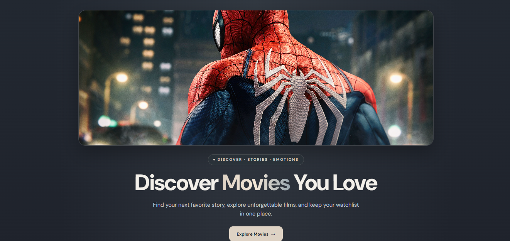
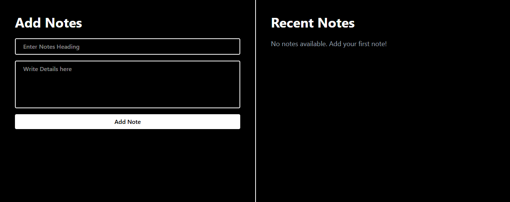
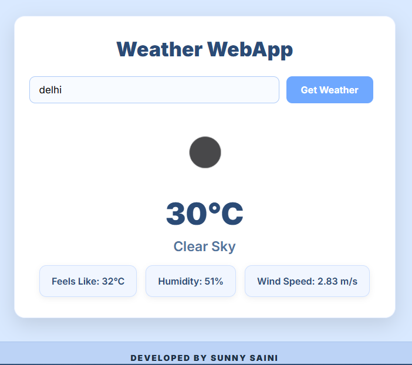

<div align="center">

# 🌲 Sunny Saini | Developer Portfolio

### Building ideas into digital experiences.

A modern, responsive portfolio built with React, Tailwind CSS, and Vite — featuring a minimalist **Forest Noir** design, selected projects, technical skills, and an interactive contact form.

<br />

<a href="https://sunnysaini-portfolio-git-main-sunny-264f.vercel.app/">
  
</a>
<a href="https://github.com/sunnysaini2004/sunnysainiPortfolio">
  
</a>

<br /><br />


</div>

---

## ✨ About the Project

This is my personal developer portfolio, created to showcase my projects, technical skills, academic journey, and approach to building web experiences.

The portfolio started as a basic HTML, CSS, and JavaScript project. As I progressed with React, I rebuilt it using reusable components, responsive layouts, and a more refined visual design.

The goal was to create a website that feels **minimal, distinctive, responsive, and easy to navigate**.

## 🎨 Design Philosophy — Forest Noir

The website follows a dark, nature-inspired design system built around deep greens, charcoal black, muted grey-green tones, and warm ivory.

| Color | Hex Code | Purpose |
|:---|:---|:---|
| Obsidian Black | `#0B0F0C` | Main backgrounds |
| Deep Forest | `#13251B` | Secondary sections |
| Forest Green | `#234A36` | Accent surfaces |
| Moss Grey | `#687A61` | Subtle highlights |
| Silver Sage | `#AEB7B0` | Borders and supporting text |
| Warm Ivory | `#F2EFE6` | Primary text |

## 🚀 Features

<table>
  <tr>
    <td width="50%">
      <h3>📱 Responsive Design</h3>
      Layouts adapted for mobile, tablet, and desktop screens.
    </td>
    <td width="50%">
      <h3>🧩 React Components</h3>
      Reusable components keep the code organized and maintainable.
    </td>
  </tr>
  <tr>
    <td width="50%">
      <h3>🧭 Active Navigation</h3>
      The navigation highlights the section currently being viewed.
    </td>
    <td width="50%">
      <h3>💻 Project Showcase</h3>
      Real project screenshots, technology tags, live demos, and GitHub links.
    </td>
  </tr>
  <tr>
    <td width="50%">
      <h3>📬 Contact Form</h3>
      EmailJS integration for sending messages directly from the portfolio.
    </td>
    <td width="50%">
      <h3>🎯 Clean UI</h3>
      Restrained spacing, subtle hover effects, and consistent typography.
    </td>
  </tr>
</table>

## 🛠️ Tech Stack

| Technology | Purpose |
|:---|:---|
| React.js | UI components and application structure |
| JavaScript (ES6+) | Application logic and interactivity |
| Tailwind CSS v4 | Responsive styling and design utilities |
| Vite | Development server and production build |
| EmailJS | Contact form email delivery |
| Git & GitHub | Version control and source code management |
| Vercel | Portfolio deployment |

## 🗂️ Featured Projects

The portfolio currently showcases these projects.

### 01. 🎬 CineScope

A movie discovery application for searching films, viewing movie details, and managing a personal watchlist.

**Tech:** React.js · Tailwind CSS · TMDB API

<a href="https://cine-scope-jet.vercel.app/">
  
</a>

<p>
  <a href="https://cine-scope-jet.vercel.app/">🌐 Live Demo</a> ·
  <a href="https://github.com/sunnysaini2004/cine-Scope">💻 Source Code</a>
</p>

### 02. 📝 NotesWebApp

A notes application that lets users create, view, and delete notes, with browser storage for persistence between sessions.

**Tech:** React.js · Tailwind CSS · Local Storage

<a href="https://sunnysaini2004.github.io/NotesWebApp/">
  
</a>

<p>
  <a href="https://sunnysaini2004.github.io/NotesWebApp/">🌐 Live Demo</a> ·
  <a href="https://github.com/sunnysaini2004/NotesWebApp">💻 Source Code</a>
</p>

### 03. 🌦️ Weather WebApp

A responsive weather application that allows users to search for a city and view current weather information.

**Tech:** HTML · CSS · JavaScript · Weather API

<a href="https://sunnysaini2004.github.io/weather-WebApp/">
  
</a>

<p>
  <a href="https://sunnysaini2004.github.io/weather-WebApp/">🌐 Live Demo</a> ·
  <a href="https://github.com/sunnysaini2004/weather-WebApp">💻 Source Code</a>
</p>

## 🧭 Portfolio Sections

| Section | Description |
|:---|:---|
| **Home** | Profile card, introduction, and social links |
| **About** | Development mindset and personal principles |
| **Projects** | Selected projects with previews and live links |
| **Skills** | Technologies organized into skill categories |
| **Academic** | Education and development journey |
| **Contact** | Contact details and email message form |

## 📂 Project Structure

The application is located inside the `Portfolio-website` directory of this repository.

```text
sunnysainiPortfolio/
└── Portfolio-website/
    ├── public/
    │   └── images/
    │       └── projects/
    │           ├── cinescope.png
    │           ├── noteswebapp.png
    │           └── weather-app.png
    ├── src/
    │   ├── assets/
    │   ├── components/
    │   │   └── layout/
    │   │       ├── SiteHeader.jsx
    │   │       └── SiteFooter.jsx
    │   ├── data/
    │   │   ├── projects.js
    │   │   └── skills.js
    │   ├── sections/
    │   │   ├── Hero.jsx
    │   │   ├── About.jsx
    │   │   ├── SelectedWork.jsx
    │   │   ├── Tools.jsx
    │   │   ├── Experience.jsx
    │   │   └── Contact.jsx
    │   ├── index.css
    │   ├── App.jsx
    │   └── main.jsx
    ├── .gitignore
    ├── index.html
    ├── package.json
    ├── package-lock.json
    └── vite.config.js
```

## ⚙️ Getting Started

Want to run the project locally? Follow these steps.

### Prerequisites

- [Node.js](https://nodejs.org/)
- npm
- An EmailJS account if you want to use the contact form

### 1. Clone the repository

```bash
git clone https://github.com/sunnysaini2004/sunnysainiPortfolio.git
```

### 2. Navigate to the application folder

```bash
cd sunnysainiPortfolio/Portfolio-website
```

### 3. Install dependencies

```bash
npm install
```

### 4. Configure EmailJS

Create a `.env.local` file inside `Portfolio-website`, alongside `package.json`.

```env
VITE_EMAILJS_SERVICE_ID=your_emailjs_service_id
VITE_EMAILJS_TEMPLATE_ID=your_emailjs_template_id
VITE_EMAILJS_PUBLIC_KEY=your_emailjs_public_key
```

Replace the example values with your own EmailJS configuration.

The EmailJS template should use these variables:

- `{{name}}`
- `{{email}}`
- `{{subject}}`
- `{{message}}`

**Security note:** Only use the EmailJS public key in the frontend. Never expose your EmailJS private key or other server-side secrets. Keep `.env.local` out of Git commits.

### 5. Start the development server

```bash
npm run dev
```

Open the local URL printed in your terminal.

### 6. Build for production

```bash
npm run build
```

### 7. Preview the production build

```bash
npm run preview
```

### 8. Run code checks

```bash
npm run lint
```

## ☁️ Deployment

The portfolio is deployed on Vercel.

**Live website:**  
https://sunnysaini-portfolio-git-main-sunny-264f.vercel.app/

For deployment from this repository, configure `Portfolio-website` as the Vercel project root directory, use `npm run build` as the build command, and set `dist` as the output directory.

Add the three EmailJS environment variables in your Vercel project settings and redeploy so the contact form can access its configuration in production.

## 👨‍💻 About Me

I'm **Sunny Saini**, an MCA student working toward becoming a full-stack developer.

I enjoy turning ideas into usable web applications, learning through practical projects, and improving my development skills one step at a time.

I'm currently focused on building stronger frontend foundations while continuing to explore backend development.

### Connect with me

- 🌐 **Portfolio:** [Visit Website](https://sunnysaini-portfolio-git-main-sunny-264f.vercel.app/)
- 💻 **GitHub:** [@sunnysaini2004](https://github.com/sunnysaini2004)
- 📧 **Email:** [Contact Me](mailto:sainisunny2004a@gmail.com)

---

<div align="center">

### Thanks for visiting! 🌲

*Learn. Build. Improve.*

If you find something interesting in this project, feel free to explore the source code.

**Developed by Sunny Saini**

</div>
